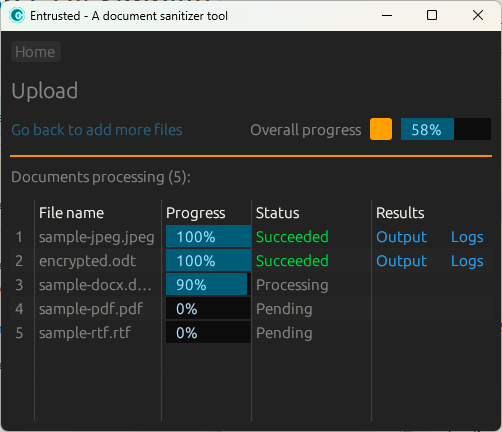

#+TITLE: Entrusted document sanitizer tool

This application is being rewritten (usability, coding practices, maintainability).
  - The current code in this branch is a partial rewrite (still with Rust). Early versions of the app were written while learning Rust during the pandemic.
  - The upcoming version, likely in early/mid 2027 will be rewritten in C (local POC in progress while learning "just enough C").

* Changes
- General
  - The next version will be written mostly in C instead of Rust
- UI
  - There will only be a Web UI accessible via the Live CD (new theme and logo)
  - There will be support for encrypting sanitized PDF files
  - The Live CD itself will be smaller (hopefully around 300 MB or less) and faster to boot
- Processing
  - The docker/podman sandboxing approach has been removed in favor of a more direct/lower-level solution
  - The sanitization process is improving in term of logic, speed and memory efficiency
  - The optional OCR step will use modern approaches instead of Tesseract (older, slower, huge installation size and memory usage)

* Problems to solve

- Learn/understand enough C, to write code almost as quickly than in Java or Rust!
- Test additional security and sandboxing rules in the Live CD with other Linux distributions than Debian (current Live CD distro)

* Screenshots
This is how it now looks like, pending a subsequent C rewrite and shipping only a Live CD in the future.

* Downloads
There are no releases yet, as there are my local POC is ongoing (I took a long break).

* References
- Processing  
  - https://docs.libreoffice.org/libreofficekit.html
  - https://mupdf.com/
  - TODO few more technical solutions to add    
- App isolation
  - https://github.com/microsoft/mimalloc
  - Linux
    - https://docs.flatpak.org/en/latest/
    - https://man7.org/linux/man-pages/man2/seccomp.2.html
    - https://landlock.io/
    - https://apparmor.net/
    - https://fedoraproject.org/wiki/SELinux
  - Windows
    - https://learn.microsoft.com/en-us/windows/win32/secauthz/appcontainer-isolation
    - https://learn.microsoft.com/en-us/windows/msix/overview
    - https://learn.microsoft.com/en-us/windows/security/application-security/application-isolation/windows-sandbox/
  - macOS
    - https://developer.apple.com/documentation/bundleresources/entitlements
    - https://developer.apple.com/documentation/security/app-sandbox
